# Mess Management App

A Flutter application for managing a mess’s officers, stock, dispensing, invoices, and monthly finances. The interface is Arabic-first, with responsive sizing and animated UI elements.

## Screenshots

The screenshots below are from the app UI and are stored in [`assets/screenshots/`](assets/screenshots/).

| | | |
|---|---|---|
| 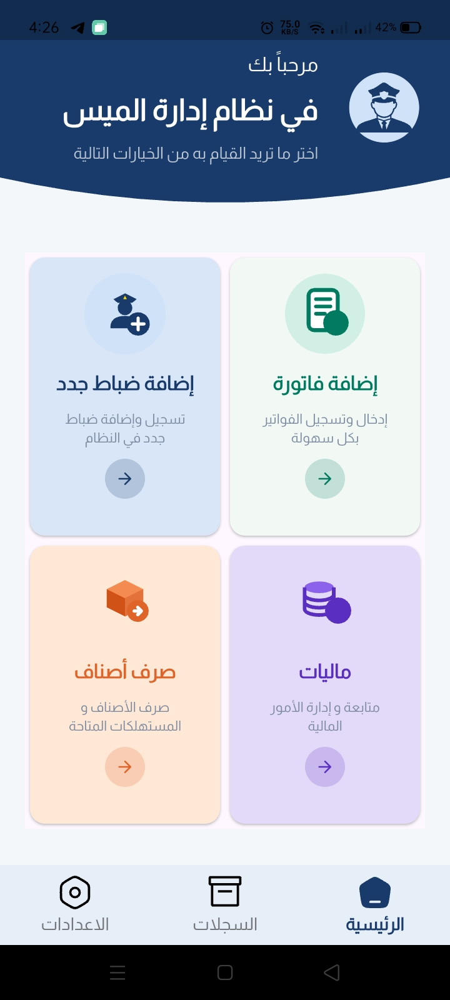 | 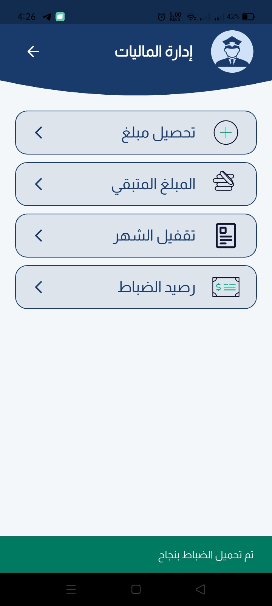 | 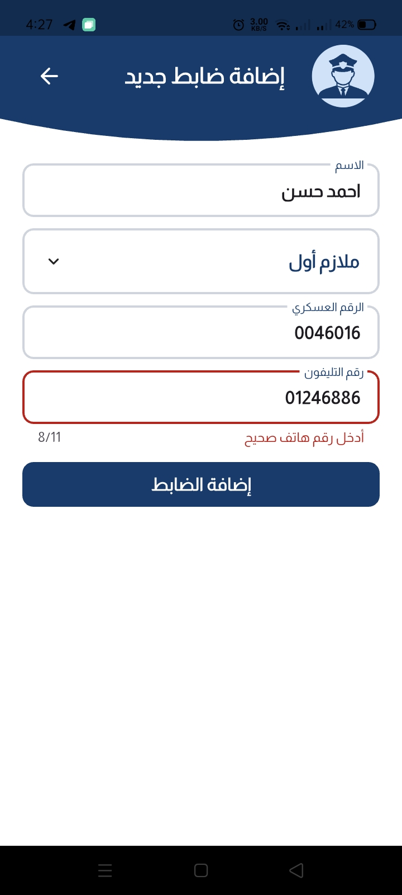 |
| 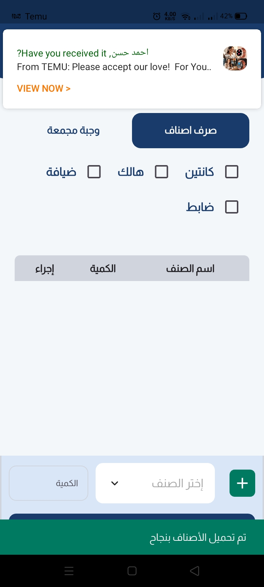 | 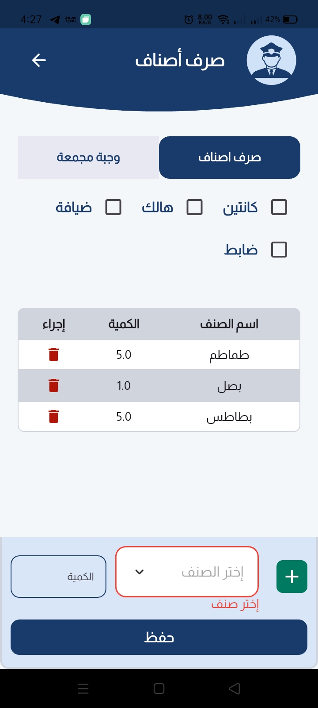 | 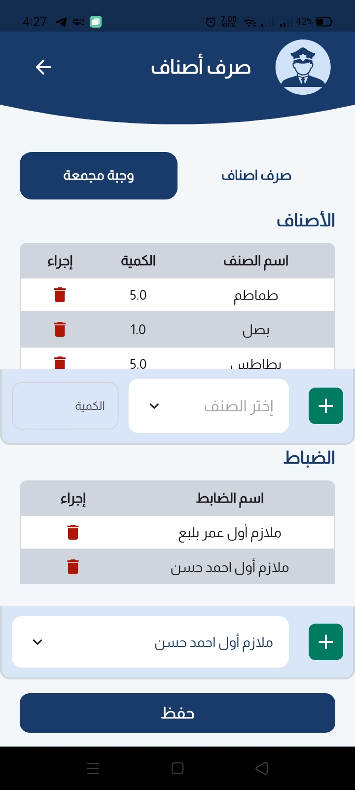 |
| 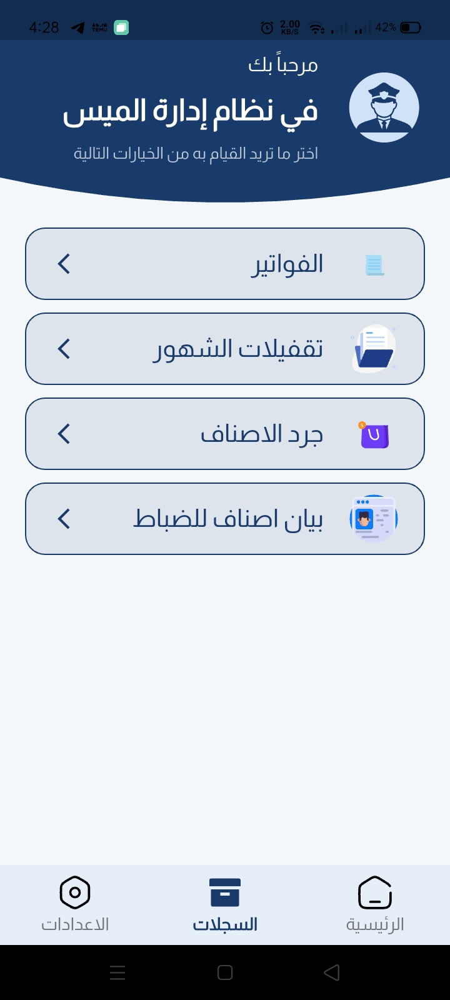 | 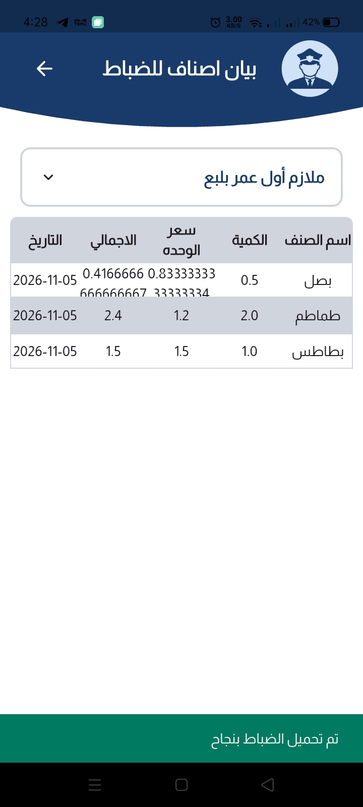 | 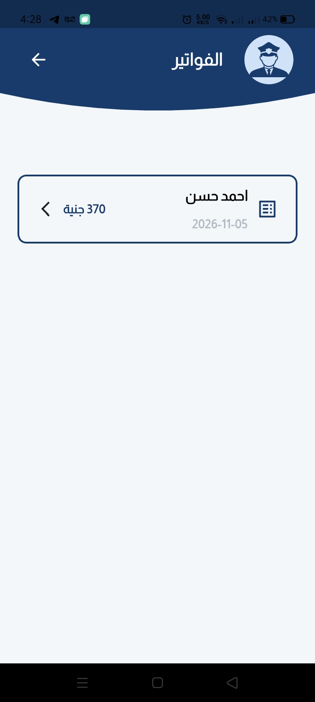 |

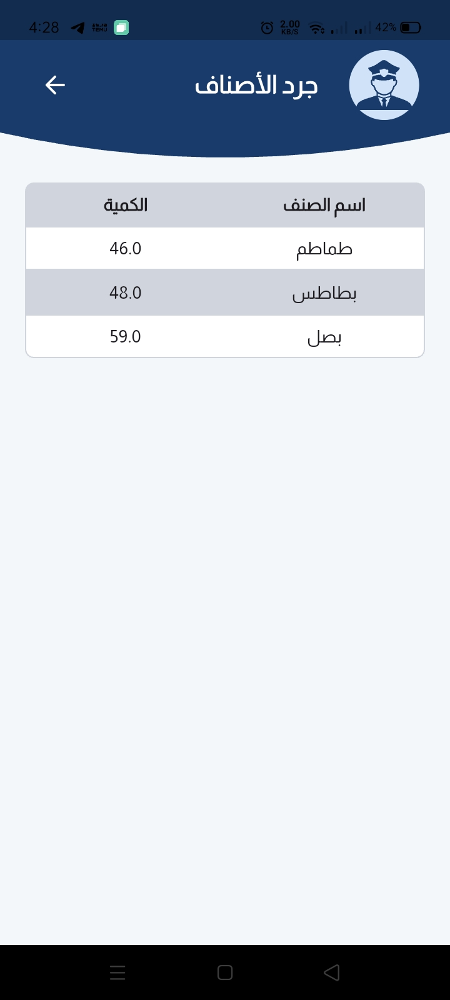
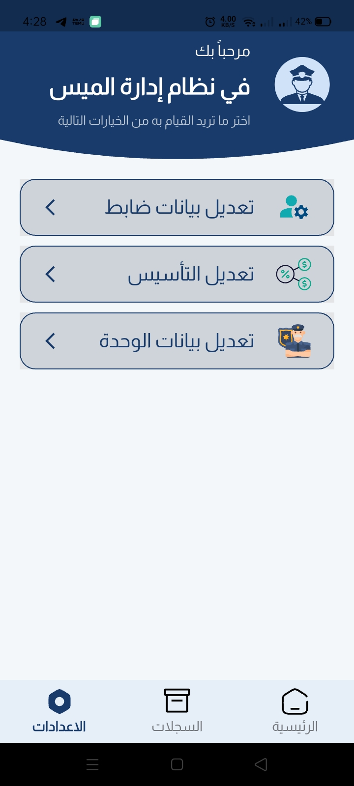
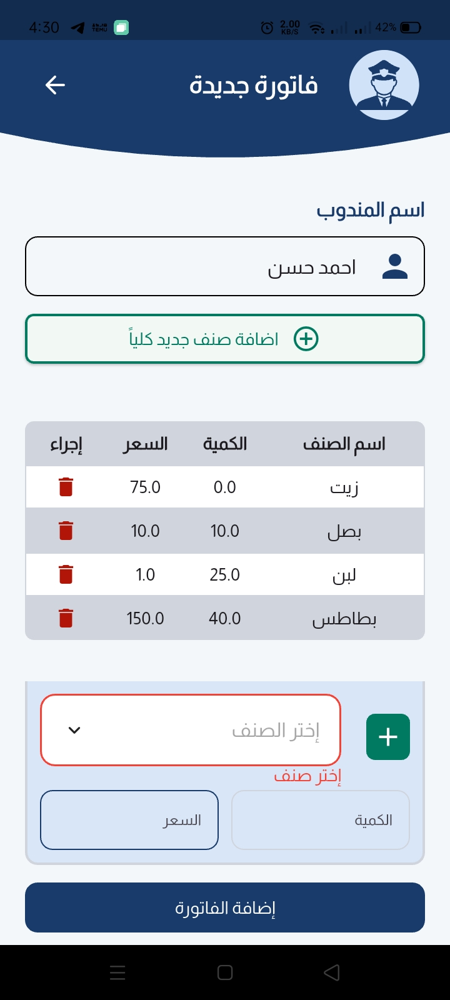

## Architecture

The app uses a **feature-oriented, layered Flutter architecture**. Features own their UI and state, while shared services and UI elements live in `core/`.

```text
lib/
├── main.dart                 # Flutter, Firebase, localization and app setup
├── config/
│   ├── l10n/                 # Localization support
│   └── routes/               # Named routes and screen construction
├── core/
│   ├── errors/               # Shared error types
│   ├── firebase/             # Firestore access manager
│   ├── models/               # Shared domain/data models
│   ├── shared_preferences/   # Local preference storage
│   ├── utils/                # Colors, constants, enums and themes
│   └── widgets/              # Reusable app bars, tiles and controls
└── features/
    ├── adding_officers/
    ├── add_new_invoice/
    ├── dispensing_items/
    ├── financials/
    ├── invoices/
    ├── closing_out_the_months/
    └── home/                  # Main shell and several management screens
```

### How the pieces fit together

- **Presentation and state:** Screens are Flutter widgets. Cubits and states (using `flutter_bloc`) manage screen state, user input, loading, success, and error flows.
- **Data and domain boundaries:** Feature data sources handle persistence and feature repositories expose operations to the presentation layer. Repository contracts and implementations are present in features that need them; `dartz` `Either` is used for some error/result flows.
- **Persistence:** `FirebaseFirestoreManager` centralizes Firestore operations for records such as officers, food items, dispensing, invoices, and closing history. `SharedPreferencesManager` stores local values used by the app, including financial settings. Firebase and shared preferences are initialized at startup.
- **Navigation:** `AppRoutes` and `Routes.onGenerateRoute` map named routes to screens. Some screens receive a model through route arguments, such as invoice and monthly-closing details.
- **Shared UI and styling:** `core/widgets` and `core/utils` provide reusable components, colors, themes, constants, and enums. `ScreenUtil` adapts dimensions to the device; Lottie and `animate_do` provide animations.
- **Localization:** The app starts with the Arabic locale and uses Flutter localization delegates. The UI labels are primarily Arabic.

## Screens and what they do

### Main navigation

- **Home dashboard** — The main landing tab with shortcuts to create an invoice, add officers, manage finances, and dispense items. The bottom navigation switches among the home, records/archive, and settings tabs.
- **Records / archive tab** — Opens invoice history, monthly-closing history, the stock inventory, and an officer-specific items statement.
- **Settings tab** — Opens officer details editing and the capital (initial funding) update dialog.

### Operations

- **New invoice** — Records a representative’s name and invoice line items, including item, quantity, and price. Users can add new food/catalog items from a bottom sheet before saving the invoice.
- **Invoices** — Displays saved invoices. Selecting an invoice opens its details, including date, line items, quantities, prices, and total.
- **Add officer** — Creates an officer record with name, rank, military ID, and phone number.
- **Update officer** — Selects an officer, edits their information and active status, or deletes the record. The screen also guards against deleting an officer with an unsettled monthly balance.
- **Dispense items** — Provides two workflows: dispense items to a destination (officer, canteen, or hospitality) or record a combo meal shared by selected officers. It validates the selection and item entries before saving.
- **Financial management** — Provides actions to collect funds for an officer, canteen, or hospitality; inspect remaining funds and officer balances; and start a monthly close.
- **Item inventory** — Shows the available food/catalog items and their quantities.
- **Officer item statement** — Select an officer to view their dispensed items, allocated quantities, unit and total prices, and dates.

### Monthly accounting

- **Month-end closing preview** — Calculates the monthly amounts for officers and other accounts, including consumption and expenses. The user reviews the figures and confirms before the close is saved and balances are updated.
- **Monthly closing history** — Lists saved monthly closes.
- **Monthly closing details** — Shows a selected close’s date, officer totals and breakdowns, plus hospitality and canteen figures.

## Technology

- Flutter and Dart
- `flutter_bloc` / Cubit for state management
- Cloud Firestore and Firebase Core for backend data
- `shared_preferences` for local settings
- `flutter_screenutil`, Lottie, and `animate_do` for responsive UI and animations

## Getting started

1. Install the Flutter SDK compatible with the Dart constraint in `pubspec.yaml`.
2. Configure Firebase for the platforms you want to run and ensure the generated platform configuration is available to the project (`firebase_options.dart` is used at startup).
3. Fetch packages and launch the app:

   ```bash
   flutter pub get
   flutter run
   ```

The repository’s Firebase configuration and project setup determine which platforms and backend environment are available.